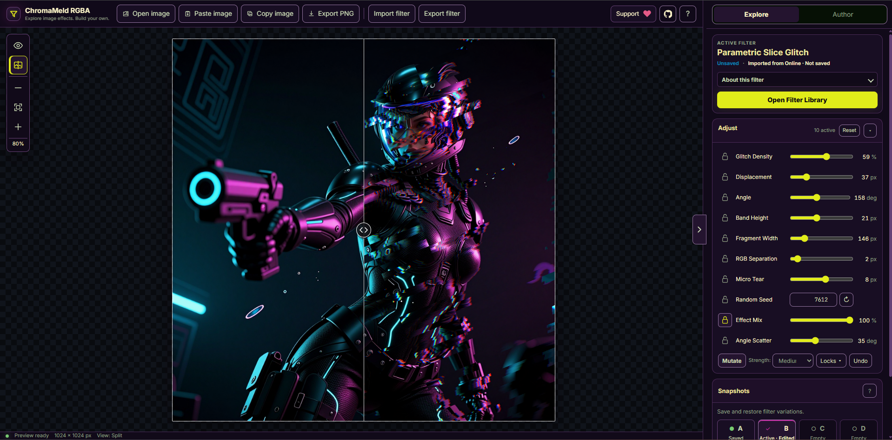

# ChromaMeld RGBA

**A browser-based editor for creating and exploring procedural image filters.**

[Launch ChromaMeld RGBA](https://anthonychimming.github.io/filter-fabjs/) · [Formula Reference](docs/FORMULA_REFERENCE.md)

ChromaMeld RGBA (formerly Filter FabJS) uses mathematical expressions to transform the red, green, blue, and alpha channels of an image. It is inspired by Adobe Filter Factory and the open-source [Filter Foundry](https://github.com/danielmarschall/filter_foundry) project.

## Screenshot



## Features

- Create filters with expressions, adjustable controls, and a live preview.
- Explore 48 built-in filters, save custom filters locally, and browse the [Online Filter Library](https://github.com/anthonychimming/filter-fabjs-library).
- Use image sampling, gradients, noise, fractals, masks, convolution, and blending in filter formulas.
- Render compatible filters with WebGPU, with automatic CPU fallback when needed.
- Import native JSON filters and supported historic Filter Factory / Filter Foundry `.afs` filters.
- Export images as PNG, with the option to embed the active filter definition as metadata.

## Development

The project uses native JavaScript modules and has no npm package dependencies. A modern browser and Node.js are required. WebGPU support is optional; availability depends on the browser and device.

Start the local development server:

```bash
npm run dev
```

Open `http://localhost:8080`. Use localhost or HTTPS for WebGPU and clipboard APIs.

For routine development, run the fast verification pipeline:

```bash
npm run verify:fast
```

It runs syntax checks, 41 smoke scripts, the production build and build-output checks. It excludes only the two Git-intensive Library Manager suites. Run those separately with `npm run test:integration` when validating Library Manager Git integration. `npm run test:fast` runs only the fast tests.

For complete release and pull request verification, run:

```bash
npm run verify
```

Fast verification does not replace this full quality gate; `npm test` also runs all 43 smoke scripts. Individual commands are available for syntax checks (`npm run check`) and production builds (`npm run build`). The build produces a deployable static site in `dist/site/` and a standalone HTML file in `dist/`.

### Verification timing

One Windows measurement (Windows 11 build 26200, Node 22.17.0, Git 2.41.0.windows.1) ran `verify:fast` in 26.85 seconds, including 16.61 seconds for tests; a separate `npm run build` took 1.45 seconds. Both exited successfully. The two excluded suites still take substantially longer on Windows: the [PR #33](https://github.com/anthonychimming/filter-fabjs/pull/33) validated sync run took 661.6 seconds, and prior manager-suite measurements were roughly 10–14 minutes. They use thousands of real Git subprocesses.

For context, the [PR #33 Linux CI run](https://github.com/anthonychimming/filter-fabjs/actions/runs/42920289386) on hosted Ubuntu 26.04.1, Node 22.23.4 and Git 2.56.0 recorded approximately 12.4 seconds for the manager suite and 11.5 seconds for sync (from log timestamps). These are equivalent individual suites, but different machines, Git and Node versions, and environments; the difference cannot be attributed to the OS alone. The Linux launcher smoke test itself reports a platform-specific skip.

## Documentation

- [Formula Reference](docs/FORMULA_REFERENCE.md) — formula syntax, functions, and renderer support
- [Programming Guide](docs/Filter_FabJS_Programming_Guide_v2.4.7.pdf) — filter authoring and examples
- [Architecture](docs/ARCHITECTURE.md) — application structure, compiler, and renderers
- [Project Status](docs/PROJECT_STATUS.md) — implementation details and known boundaries
- [Filter Library](docs/FILTER_LIBRARY.md) — filter metadata, storage, and portable packages
- [Library Manager](docs/LIBRARY_MANAGER.md) — maintenance of the Online Filter Library
- [Analytic Shapes](docs/ANALYTIC_SHAPES.md) — mask and coordinate conventions
- [Brand & Theme](docs/BRAND_THEME.md) — visual system and UI tokens
- [Changelog](CHANGELOG.md) — release history

## Contributing

Bug reports, compatibility findings, filter examples, and focused improvements are welcome. See [CONTRIBUTING.md](CONTRIBUTING.md) for guidance.

## Support 🩷

ChromaMeld RGBA is an independently developed, open-source project. If you find it useful and would like to support its continued development, you can [support ChromaMeld on Ko-fi](https://ko-fi.com/chromameld).

## License

ChromaMeld RGBA is distributed under the **GNU General Public License v2.0 or later**. See [LICENSE](LICENSE).
