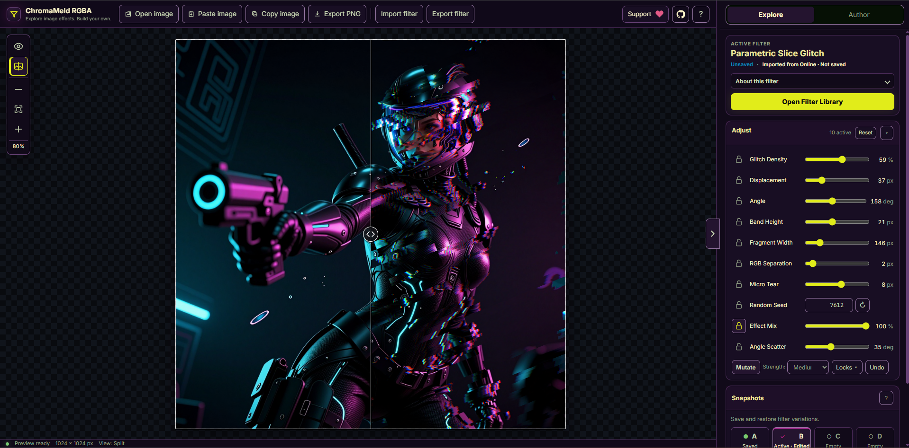

# ChromaMeld RGBA

**A browser-based editor for creating and exploring procedural image filters.**

[Launch ChromaMeld RGBA](https://anthonychimming.github.io/filter-fabjs/) · [Formula Reference](docs/FORMULA_REFERENCE.md)

## Screenshot



ChromaMeld RGBA (formerly Filter FabJS) uses mathematical expressions to transform the red, green, blue, and alpha channels of an image. It is inspired by Adobe Filter Factory and the open-source [Filter Foundry](https://github.com/danielmarschall/filter_foundry) project.

## Features

- Create filters with expressions, adjustable controls, and a live preview.
- Explore 48 built-in filters, save custom filters locally, and browse the [Online Filter Library](https://github.com/anthonychimming/filter-fabjs-library).
- Use image sampling, gradients, noise, fractals, masks, convolution, and blending in filter formulas.
- Render compatible filters with WebGPU, with automatic CPU fallback when needed.
- Import native JSON filters and supported historic Filter Factory / Filter Foundry `.afs` filters.
- Export images as PNG, with the option to embed the active filter definition as metadata.

## Development

The project uses native JavaScript modules and has no npm package dependencies. A modern browser and Node.js are required. WebGPU support is optional; availability depends on the browser and device.

Start the local development server:

```bash
npm run dev
```

Open `http://localhost:8080`. Use localhost or HTTPS for WebGPU and clipboard APIs.

Run the full verification pipeline:

```bash
npm run verify
```

Individual commands are available for syntax checks (`npm run check`), tests (`npm test`), and production builds (`npm run build`). The build produces a deployable static site in `dist/site/` and a standalone HTML file in `dist/`.

## Documentation

- [Formula Reference](docs/FORMULA_REFERENCE.md) — formula syntax, functions, and renderer support
- [Programming Guide](docs/Filter_FabJS_Programming_Guide_v2.4.7.pdf) — filter authoring and examples
- [Architecture](docs/ARCHITECTURE.md) — application structure, compiler, and renderers
- [Project Status](docs/PROJECT_STATUS.md) — implementation details and known boundaries
- [Filter Library](docs/FILTER_LIBRARY.md) — filter metadata, storage, and portable packages
- [Library Manager](docs/LIBRARY_MANAGER.md) — maintenance of the Online Filter Library
- [Analytic Shapes](docs/ANALYTIC_SHAPES.md) — mask and coordinate conventions
- [Brand & Theme](docs/BRAND_THEME.md) — visual system and UI tokens
- [Changelog](CHANGELOG.md) — release history

## Contributing

Bug reports, compatibility findings, filter examples, and focused improvements are welcome. See [CONTRIBUTING.md](CONTRIBUTING.md) for guidance.

## License

ChromaMeld RGBA is distributed under the **GNU General Public License v2.0 or later**. See [LICENSE](LICENSE).
